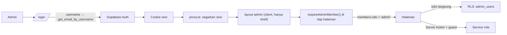

# Struktur admin (CMS) — Albana Speech Academy

> **Rancangan historis sebelum pembersihan skema 15 November.** Bagian yang menyebut `members`, `privilege_*`, `registrations`, atau sidebar dinamis tidak lagi menggambarkan implementasi. Lihat [skema database](../data/database-schema.md), `front/app/(admin)/admin/layout.tsx`, dan `front/lib/albana-routes.ts` untuk keadaan terkini.

**Status:** dibaca dari `front/app/(admin)/admin/` dan proyek Supabase `clgjsekfnexmanjdxmqy` pada 15 November 2026. Dokumen ini menetapkan struktur sasaran dan memetakan setiap menu ke rute, tabel, dan jalur tulisnya. Susunan sidebar yang diusulkan berasal dari [peta menu](README.md); gaya visual mengikuti [design system admin](../design/admin-design-system.md).

## 1. Prinsip

1. **Urutan mengikuti pekerjaan harian**: operasional di atas, pengaturan di bawah.
2. **Satu menu, satu urusan.** Sesi diedit di dalam Batch; profil Alan di dalam Trainer.
3. **Menu bukan otorisasi.** Menyembunyikan tautan tidak melindungi rute; setiap halaman, action, dan handler memeriksa admin sendiri.
4. **Hanya data nyata.** Dashboard tidak menampilkan grafik atau angka contoh.

## 2. Autentikasi dan peran



| Peran | Disimpan di | Boleh |
| --- | --- | --- |
| `admin` | `admin_users.role` | Baca, tambah, ubah semua modul CMS. |
| `adminsuper` | `admin_users.role` | Semua hak `admin` + **hapus** pada `academy`, `bank_accounts`, `testimonials`, `media_assets`. |

**Keadaan saat ini:** `layout.tsx` admin adalah komponen client yang hanya menggambar shell; ia **tidak** memeriksa sesi. Perlindungan bergantung pada `proxy.ts` dan pemanggilan guard di setiap halaman, sehingga halaman baru yang lupa memanggil guard akan terbuka. Guard halaman (`lib/server/admin-guard.ts`) memeriksa `members.role = 'admin'`, sedangkan database memeriksa `admin_users`. Menambah admin berarti mengisi **kedua** tabel sampai guard disatukan. Sistem izin per modul warisan (`admin_roles`, `admin_role_permissions`, `lib/check-permission.ts`) masih ada di kode tetapi tabelnya kosong dan tidak menjadi bagian struktur Albana.

Prosedur menambah admin ada di [lingkungan dan operasi](../project/environment-setup.md#6-menambah-admin).

## 3. Sidebar sasaran

| # | Grup | Menu | Rute | Status rute |
| --- | --- | --- | --- | --- |
| 1 | — | Dashboard | `/admin` | Ada; kini membaca `members` (warisan), perlu diganti metrik Albana |
| 2 | Operasional | Pendaftar | `/admin/pendaftar` | Ada; **sumber data salah** |
| 3 | | Tagihan & pembayaran | `/admin/tagihan` | Ada |
| 4 | Kelas & penawaran | Program | `/admin/program` | Ada |
| 5 | | Batch & jadwal | `/admin/batch` | Ada |
| 6 | | Bundling | `/admin/bundling` | Ada |
| 7 | | Trainer | `/admin/trainer` | Ada |
| 8 | Konten website | Artikel | `/admin/artikel` | Ada |
| 9 | | Media & dokumentasi | `/admin/media`, `/admin/galeri` | Ada (dua rute, satu label) |
| 10 | | Testimoni | `/admin/testimoni` | Ada |
| 11 | | Partner | `/admin/partner` | Ada |
| 12 | | Profil akademi | `/admin/profil-akademi` | **Belum** |
| 13 | Pengaturan | Kontak publik | `/admin/pengaturan/kontak` | **Belum** — kini panel Kontak di `/admin/settings` |
| 14 | | Rekening pembayaran | `/admin/pengaturan/rekening` | **Belum ada layar sama sekali** |
| 15 | | Akun admin | `/admin/pengaturan/admin` | **Belum** |

Profil saya, tema, dan keluar berada di menu akun pada topbar, bukan di sidebar.

**Sidebar terpasang hari ini** (`app/(admin)/admin/layout.tsx`): grup **PENDAFTARAN** (Data Pendaftar, Tagihan Albana) dan **KATALOG** (Program, Bundling, Batch, Trainer, Artikel, Gallery, Media Albana, Partner Inhouse, Testimoni). Layout membaca `privilege_groups` dan `privilege_items`; tabel itu baru memuat tujuh butir, sehingga Tagihan, Bundling, Media, dan Partner bergantung pada daftar bawaan di kode.

## 4. Rincian modul

### 4.1 Dashboard — `/admin`

| Kartu | Sumber | Tindakan |
| --- | --- | --- |
| Tagihan menunggu | `academy_invoices` berstatus `pending` | Buka Tagihan |
| Pendaftar 7 hari terakhir | `academy_registrations.received_at` | Buka Pendaftar |
| Batch aktif dan sesi berikutnya | `batches` dengan `is_active` | Buka Batch |
| Yang belum siap | Rekening aktif kosong, program tanpa batch, media/artikel draf | Buka modul terkait |

### 4.2 Operasional

| Menu | Tabel | Jalur tulis | Tampilan | Aksi |
| --- | --- | --- | --- | --- |
| Pendaftar | `academy_registrations`, `academy_registration_items` | Hanya baca (service role sesudah guard) | Daftar: nama, WhatsApp, program/bundling, batch, cara bayar, status tagihan, waktu. Detail: seluruh `answers`. | Saring per batch dan status; buka WhatsApp; ekspor CSV (usulan). |
| Tagihan & pembayaran | `academy_invoices` + pendaftaran + rekening | Server Action `resolveInvoice` → RPC `resolve_academy_invoice` | Daftar per status; tiap baris menampilkan **total persis** (subtotal + kode unik), tahap, rekening. | Verifikasi atau tolak dengan konfirmasi. Tidak ada tombol “lunas” tanpa pemeriksaan nominal. |

### 4.3 Kelas dan penawaran

| Menu | Rute | Tabel | Jalur tulis | Bidang utama |
| --- | --- | --- | --- | --- |
| Program | `/admin/program`, `/create`, `/[slug]/edit` | `programs` | CMS langsung (`ProgramForm`) | Judul, deskripsi, materi, harga, harga normal, naskah tiga pertanyaan formulir. |
| Batch & jadwal | `/admin/batch` | `batches` | CMS langsung | Program, judul, sesi (tanggal/jam WIB), tempat, alamat, harga, DP %, jenis formulir, aktif, buka pendaftaran. |
| Bundling | `/admin/bundling` | `bundle_offers` | Server Action `saveBundle` | Judul, program Speaker, program Sertifikasi, harga, DP %, aktif. |
| Trainer | `/admin/trainer` | `trainers` | CMS langsung | Nama, bio, keahlian, foto. |

Aturan antarmuka yang mengikuti database: mengaktifkan satu batch menonaktifkan batch lain pada program yang sama (tampilkan peringatan sebelum simpan); bundling tidak dapat diaktifkan tanpa harga; slug dibuat otomatis dan tidak diedit saat membuat.

### 4.4 Konten website

| Menu | Rute | Tabel / bucket | Jalur tulis | Catatan |
| --- | --- | --- | --- | --- |
| Artikel | `/admin/artikel`, `/baru`, `/[slug]` | `articles` | CMS langsung | Editor blok; tombol terbit/tarik. |
| Media per program | `/admin/media` | `media_assets`, bucket `academy-media` | `POST /api/upload`; actions `addYoutube`, `setMediaPublished`, `saveMediaSettings` | Unggahan masuk sebagai draf. Batas resolusi minimal diatur di sini. |
| Galeri beranda | `/admin/galeri`, `/addGallery` | `gallery`, bucket `gallery` | `POST /api/upload` (`purpose=landing`) + CMS langsung | Langsung tampil publik. |
| Testimoni | `/admin/testimoni` | `testimonials`, bucket `testimonials` | CMS langsung | Kutipan 20–30 kata; tampilkan penghitung kata. |
| Partner | `/admin/partner`, `/addPartner` | `academy_partners` | Actions `savePartner`, `togglePartner` | Tampil di halaman Inhouse bila terbit. |
| Profil akademi | belum ada | `academy` | CMS langsung | Nama, metode belajar, kebijakan penjadwalan ulang. |

### 4.5 Pengaturan

| Menu | Tabel | Catatan |
| --- | --- | --- |
| Kontak publik | `contact_channels` | Empat jenis tetap: alamat, Instagram, WhatsApp, email. |
| Rekening pembayaran | `bank_accounts` | **Belum ada layar yang menulis tabel ini**: `lib/admin-modules.ts` menunjuk `/admin/pengaturan`, rute yang tidak ada, dan `/admin/settings` hanya memuat Kontak. Privat. Tepat satu rekening aktif; mengganti rekening aktif tidak mengubah tagihan lama. Layar terpisah dari Kontak agar nomor rekening tidak tertukar dengan data publik. |
| Akun admin | `admin_users` (+ `members` sementara) | Usulan; saat ini lewat SQL. |

## 5. Struktur folder sasaran

```text
front/app/(admin)/admin/
├── layout.tsx                 # guard + shell (sidebar, topbar)
├── page.tsx                   # dashboard
├── denied/page.tsx
├── pendaftar/                 # page.tsx, [id]/page.tsx
├── tagihan/                   # page.tsx, actions.ts
├── program/                   # page.tsx, create/, [slug]/edit/
├── batch/                     # page.tsx
├── bundling/                  # page.tsx, actions.ts
├── trainer/                   # page.tsx
├── artikel/                   # page.tsx, baru/, [slug]/
├── media/                     # page.tsx, actions.ts
├── galeri/                    # page.tsx, addGallery/
├── testimoni/                 # page.tsx
├── partner/                   # page.tsx, actions.ts, addPartner/
├── profil-akademi/            # USULAN
└── pengaturan/                # USULAN: kontak/, rekening/, admin/

front/components/admin/        # komponen bersama + per modul
front/lib/admin-modules.ts     # registri modul → tabel → label
front/lib/cms-fields.ts        # definisi bidang per koleksi
front/lib/cms-validation.ts    # validasi server
```

Konvensi: nama folder huruf kecil berbahasa Indonesia sesuai label menu; mutasi berhak berada di `actions.ts` di samping `page.tsx`; setiap `actions.ts` diawali `"use server"` dan pemanggilan guard.

## 6. Rute warisan

Rute berikut berasal dari proyek komunitas, masih dapat dibuka lewat URL, dan **tidak** termasuk struktur Albana:

`acara`, `admins`, `affiliate-payout`, `aktivitas`, `attendance`, `cms-akademi`, `cms-komunitas`, `confirmation`, `funnel`, `logs`, `members`, `mentoring`, `packages`, `payment`, `referral`, `resources`, `revenue`, `roles`, `settings`, `sidebar-layout`, `transactions`, `venue`, `voucher`.

Banyak di antaranya dibuat untuk tabel komunitas (acara, venue, paket, absensi) yang tidak ada di proyek ini; perilakunya saat dibuka belum diuji. Jangan menautkannya dari sidebar. Penghapusan mengikuti [kandidat pembersihan](../project/cleanup-candidates.md); `settings` dipertahankan sampai Kontak dan Rekening punya rute baru.

## 7. Pekerjaan untuk mencapai struktur sasaran

| Urutan | Pekerjaan | Ukuran |
| --- | --- | --- |
| 1 | Alihkan `/admin/pendaftar` ke `academy_registrations` + halaman detail jawaban. | Sedang — **pemblokir rilis** |
| 2 | Satukan guard admin ke `admin_users`. | Kecil — **pemblokir rilis** |
| 3 | Buat layar Rekening pembayaran (tabel `bank_accounts`), lalu isi rekening aktif. Tanpa ini semua pendaftaran ditolak. | Kecil — **pemblokir rilis** |
| 4 | Lengkapi `privilege_items` (Tagihan, Bundling, Media, Partner) dan susun ulang grup sesuai tabel sasaran. | Kecil — satu migrasi data |
| 5 | Ganti isi dashboard dengan empat kartu pada 4.1. | Sedang |
| 6 | Pindahkan Kontak dan Rekening ke `/admin/pengaturan/*`; buat Profil akademi. | Sedang |
| 7 | Hapus rute warisan dan tabelnya. | Besar — sesudah rilis |
