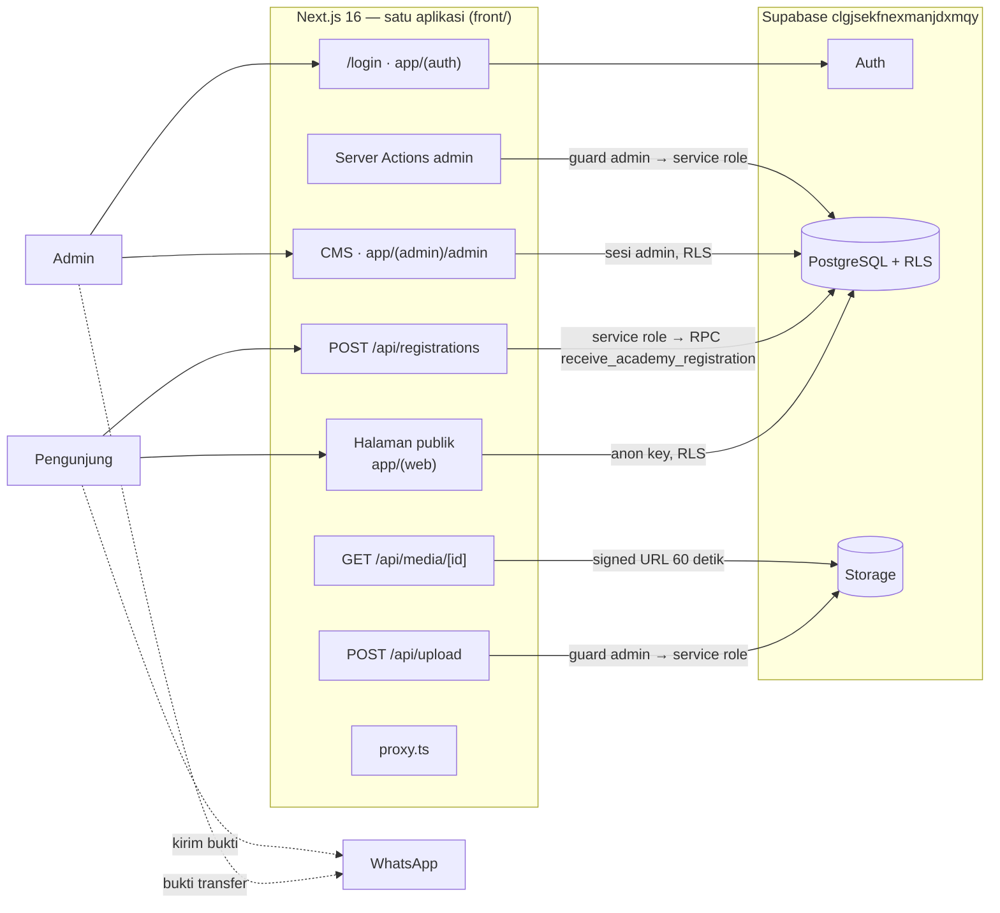
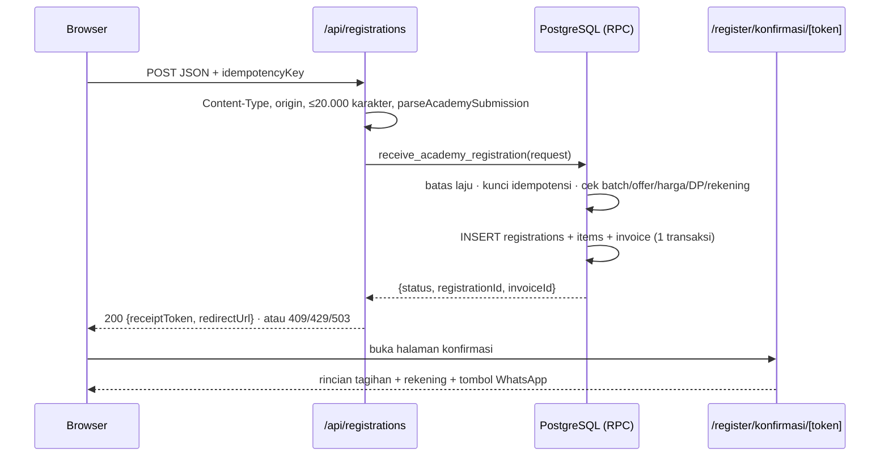

# Arsitektur sistem — Albana Speech Academy

> **Sebagian isi adalah audit sebelum pembersihan skema 15 November.** Guard admin kini memakai `admin_users`, Pendaftar membaca `academy_registrations`, dan rute komunitas lama dibatasi oleh `front/lib/albana-routes.ts`. Lihat [skema database](../data/database-schema.md) untuk 18 tabel terkini.

**Status:** dibaca dari kode `front/` dan proyek Supabase `clgjsekfnexmanjdxmqy` pada 15 November 2026. Dokumen ini menggantikan [arsitektur 10 November](../data/system-architecture.md), yang kini menjadi catatan riwayat. Label: **Aktif** (dipakai produk Albana), **Warisan** (sisa proyek komunitas, masih ada di kode atau database), **Usulan** (belum dikerjakan).

## 1. Gambaran



Tidak ada layanan backend terpisah. Semua logika server berada di Server Components, Server Actions, dan Route Handler aplikasi yang sama; aturan data yang harus atomik berada di fungsi PostgreSQL.

## 2. Stack

| Lapisan | Pilihan terpasang | Catatan |
| --- | --- | --- |
| Kerangka | Next.js 16.2 App Router, React 19.2, TypeScript 5 | `proxy.ts` menggantikan `middleware.ts` (konvensi Next 16). |
| Antarmuka | Tailwind CSS 4, shadcn/Radix, lucide-react, next-themes | Token di `app/globals.css`; lihat [design system akademi](../design/academy-design-system.md) dan [design system admin](../design/admin-design-system.md). |
| Editor | BlockNote 0.50 (Mantine) | Isi artikel tersimpan di `articles.body_blocks` (JSONB) dan `body` (teks). |
| Gerak | GSAP, Lenis | Hanya halaman publik. |
| Data | `@supabase/supabase-js` 2, `@supabase/ssr` | Tiga klien: browser (anon), server (cookie sesi), service role. |
| Media | Sharp 0.34 | Gambar → WebP; MP4 hanya dibaca resolusinya. |
| Email | Nodemailer, Resend | **Warisan** — dipakai alur komunitas; alur Albana tidak mengirim email. |
| AI | groq-sdk | **Warisan** — analisis minat anggota komunitas. |
| Uji | `node --test` pada berkas `lib/*.test.mjs` | Belum ada uji browser. |

## 3. Struktur kode

```text
front/
├── app/
│   ├── layout.tsx                 # root layout, tema, font
│   ├── (web)/                     # AKTIF — halaman publik
│   │   ├── page.tsx               # beranda
│   │   ├── program/[slug]/
│   │   ├── register/              # [program], konfirmasi/[token], preview
│   │   └── artikel/               # daftar, [slug]
│   ├── (auth)/                    # login, forgot-password, reset-password
│   ├── (admin)/admin/             # CMS; rincian di admin-structure.md
│   ├── api/
│   │   ├── registrations/route.ts # AKTIF — penerimaan pendaftaran
│   │   ├── upload/route.ts        # AKTIF — unggah media admin
│   │   ├── media/[id]/route.ts    # AKTIF — signed URL media privat
│   │   ├── member/**              # WARISAN — profil anggota komunitas
│   │   └── portfolio/**           # WARISAN
│   ├── auth/{callback,confirm}/   # pertukaran kode Supabase Auth
│   ├── (checkout)/, (form)/, myprofile/, preview-email/   # WARISAN
│   └── privacy/, terms/
├── components/
│   ├── home/ program/ register/ registration/ article/ layout/ ui/   # AKTIF
│   ├── admin/                     # AKTIF + WARISAN bercampur
│   └── community/ member/ galeri/ kolaborasi/ landing/ tentang/      # WARISAN
├── lib/
│   ├── server/                    # I/O khusus server (import "server-only")
│   ├── supabase/                  # client.ts, server.ts, service-role.ts
│   ├── actions/                   # Server Actions — sebagian besar WARISAN
│   └── *.ts + *.test.mjs          # aturan murni dan ujinya
├── supabase/migrations/           # berkas SQL; TIDAK identik dengan riwayat remote
└── proxy.ts                       # sesi, pengalihan subdomain — masih berlogika WARISAN
```

**Aturan penempatan.** Rute hanya menyusun layar dan memanggil guard. Aturan yang dapat diuji tanpa jaringan (validasi kiriman, hitung tagihan, urutan kontak) berada di `lib/*.ts`. Semua akses yang memakai rahasia berada di `lib/server/` atau `lib/supabase/service-role.ts` dan tidak boleh diimpor komponen client.

### Modul inti Albana

| Berkas | Tanggung jawab |
| --- | --- |
| `lib/academy-registration-input.ts` | `parseAcademySubmission` — validasi dan normalisasi kiriman formulir. |
| `lib/billing.ts` | `initialBill` (nominal lunas/DP), `nextUniqueCode` (kode 1–999 yang bebas). |
| `lib/server/receive-registration.ts` | Memanggil RPC penerimaan dengan klien berhak. |
| `lib/server/registration-batch.ts` | Memilih batch yang menerima untuk sebuah program. |
| `lib/server/bundle-offer.ts` | Membaca penawaran bundling yang layak tampil. |
| `lib/server/academy-billing.ts` | `academyBillingClient` — klien service role untuk tagihan. |
| `lib/server/catalog.ts`, `program-showcase.ts`, `public-articles.ts`, `public-contacts.ts` | Bacaan publik. |
| `lib/server/admin-guard.ts`, `admin-auth.ts` | Guard halaman dan sesi admin. |
| `lib/media-prepare.ts`, `lib/cms-media.ts` | Batas ukuran, konversi WebP, pembacaan resolusi MP4. |

## 4. Tiga jalur akses data

Memahami jalur mana yang dipakai sebuah fitur menentukan di mana otorisasi harus benar.

| Jalur | Klien | Pagar keamanan | Dipakai oleh |
| --- | --- | --- | --- |
| **A. Baca publik** | Anon key dari Server Component | Grant `anon` + kebijakan RLS `*_public` | Beranda, program, artikel, kontak, galeri. |
| **B. Tulis CMS langsung** | Sesi admin dari browser atau server | RLS memeriksa `auth.uid()` ada di `admin_users` | Program, Batch, Trainer, Artikel, Galeri, Testimoni, Kontak. |
| **C. Operasi berhak** | Service role (melewati RLS) | **Hanya** guard di kode sebelum pemanggilan | Pendaftaran, Tagihan, Bundling, Partner, Media, unggah. |

Jalur C tidak punya pagar di database: bila sebuah action lupa memanggil guard, operasinya terbuka. Setiap Server Action dan Route Handler di jalur ini wajib memeriksa admin pada baris pertama.

## 5. Alur pendaftaran



Invarian yang dijaga database, bukan aplikasi:

- **Snapshot harga.** `price_idr_at_signup` dan `dp_percent_at_signup` disalin saat kirim; perubahan batch tidak mengubah tagihan lama.
- **Idempotensi.** `idempotency_key` unik; `submission_hash` membedakan kirim ulang yang sama dari isi yang berubah.
- **Kode unik.** Indeks unik parsial `(bank_account_id, unique_code) WHERE status = 'pending'` mencegah dua tagihan terbuka bernominal sama pada satu rekening.
- **Satu tagihan per tahap.** `(registration_id, stage)` unik; tahap `initial` dan `remaining`.
- **Satu batch aktif per program.** Indeks unik parsial pada `batches(program_slug) WHERE is_active`, dibantu dua trigger.

Verifikasi dilakukan admin melalui `resolve_academy_invoice(invoice_id, decision, reviewer)`. Keputusan `verified` pada tagihan `initial` berjenis DP membuat tagihan `remaining`.

## 6. Alur media

| Tujuan | Bucket | Publik | Jalur |
| --- | --- | --- | --- |
| Foto/video program dan batch | `academy-media` | Tidak | Unggah → draf di `media_assets` → admin menerbitkan → `GET /api/media/[id]` memberi signed URL 60 detik. |
| Galeri beranda | `gallery` | Ya | Unggah dengan `purpose=landing` → URL publik disimpan di `gallery.image_url`. |
| Foto testimoni | `testimonials` | Ya | URL publik di `testimonials.photo_url`. |
| Video YouTube | — | — | Baris `media_assets` dengan `provider='youtube'`; `object_key` berisi ID video. |

Resolusi minimal dibaca dari `system_settings` (`albana_media_min_image_width`, `albana_media_min_image_height`, `albana_media_min_video_short_side`); bila kosong dipakai 1280, 720, dan 720.

## 7. Sesi dan `proxy.ts`

`proxy.ts` menyegarkan sesi Supabase di setiap permintaan halaman dan masih memuat logika subdomain proyek asal: domain bawaan `panggungkreator.web.id`, pengalihan `/login`, `/register`, `/myprofile` ke domain akar, dan cookie lintas subdomain. Untuk Albana yang memakai satu domain, logika ini tidak diperlukan. **Risiko:** `/register` termasuk jalur yang dialihkan; uji pada domain produksi sebelum rilis, dan sederhanakan proxy saat pembersihan.

## 8. Utang arsitektur

| # | Masalah | Akibat | Arah perbaikan |
| --- | --- | --- | --- |
| 1 | Dua sumber kebenaran admin: guard kode memeriksa `members.role = 'admin'`, RLS memeriksa `admin_users`. | Akun yang hanya ada di salah satu tabel lolos sebagian. | Pilih `admin_users`; ubah guard, lalu lepas ketergantungan pada `members`. |
| 2 | `/admin/pendaftar` membaca `registrations`, pendaftaran baru masuk `academy_registrations`. | Layar pendaftar kosong meski ada pendaftaran. | Alihkan layar ke tabel baru, lalu arsipkan tabel lama. |
| 3 | Dua tabel galeri/media (`gallery` dan `media_assets`) dengan proses unggah berbeda. | Admin bingung menaruh foto di mana. | Satu label sidebar, dua tampilan; satukan tabel pada revisi berikut. |
| 4 | Riwayat migrasi repo berbeda dari remote. | `supabase db push` dari repo akan mencoba menerapkan migrasi komunitas. | Lihat [lingkungan dan operasi](../project/environment-setup.md#4-migrasi-database). |
| 5 | ±35 rute admin, 11 tabel, dan `proxy.ts` warisan komunitas. | Permukaan serangan dan lint (542 galat) membesar. | Ikuti [kandidat pembersihan](../project/cleanup-candidates.md). |
| 6 | Sesi batch tersimpan di `batches.sessions` (JSONB) sementara tabel `sessions` masih ada dan kosong. | Dua tempat untuk data yang sama. | Hapus tabel `sessions` setelah dipastikan tidak dirujuk. |

## Dokumen terkait

[PRD](../project/product-requirements.md) · [Skema database](../data/database-schema.md) · [Kontrol akses](../data/access-control.md) · [Struktur admin](admin-structure.md) · [Referensi API](api-reference.md) · [Peta menu dan diagram HTML](README.md)
