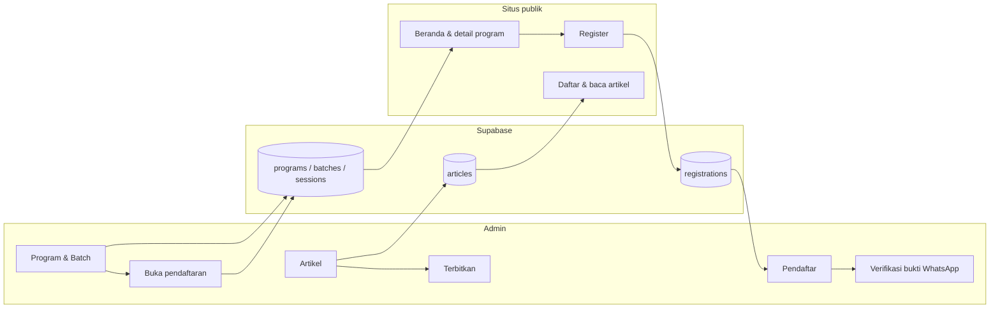
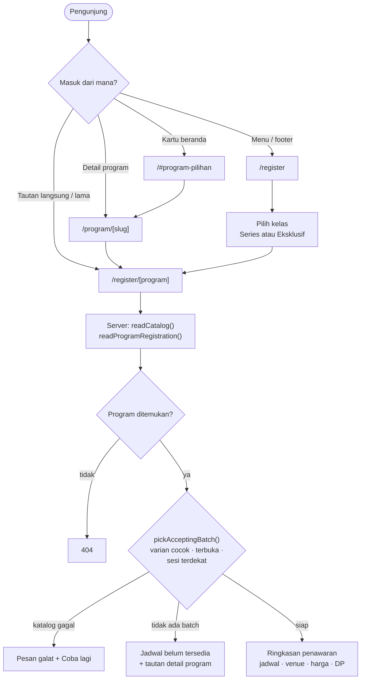
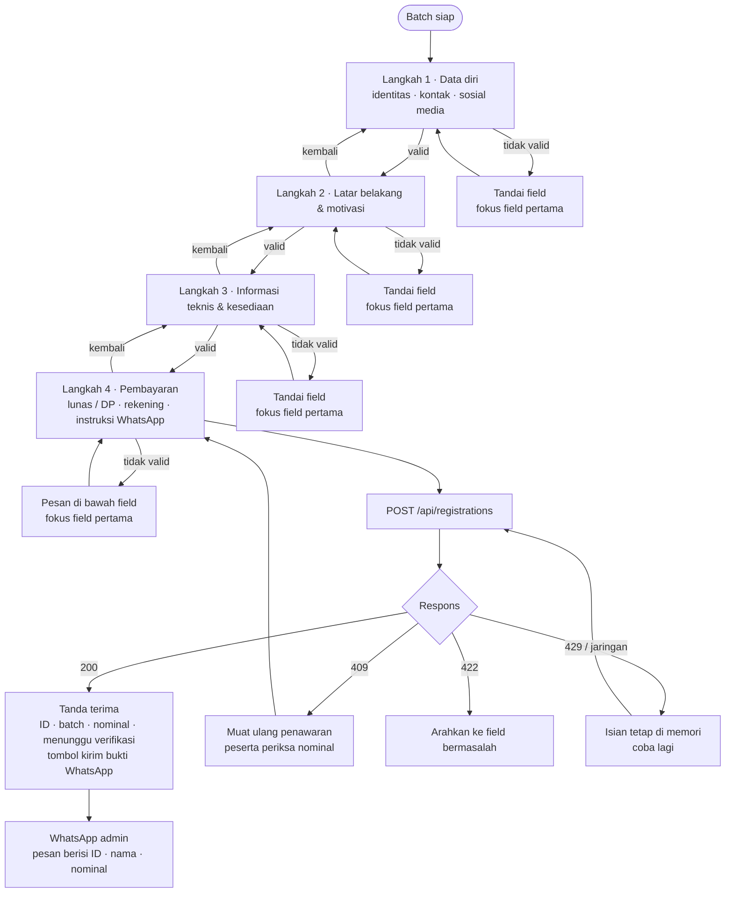
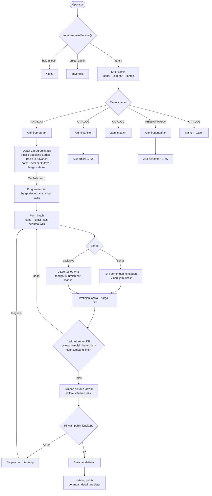
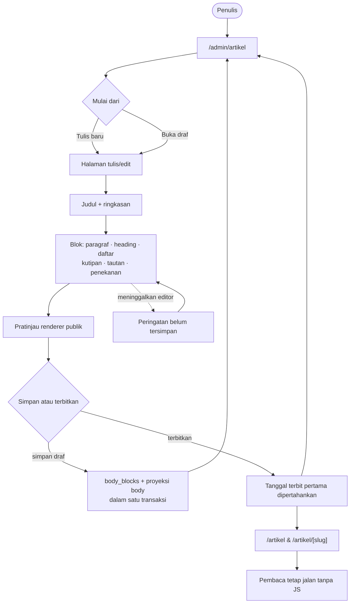
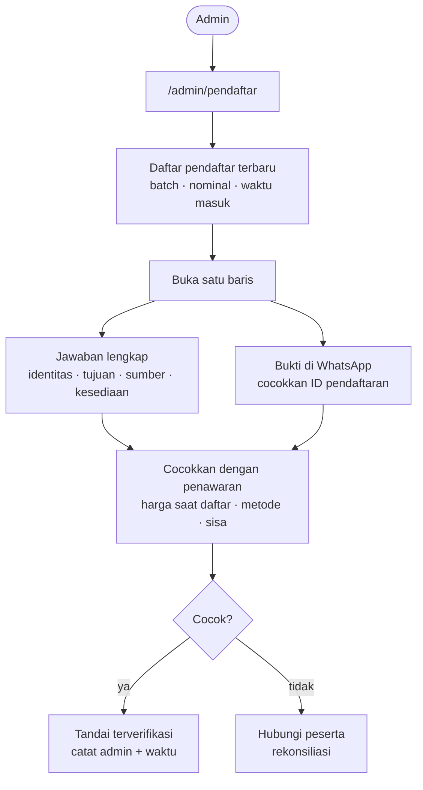
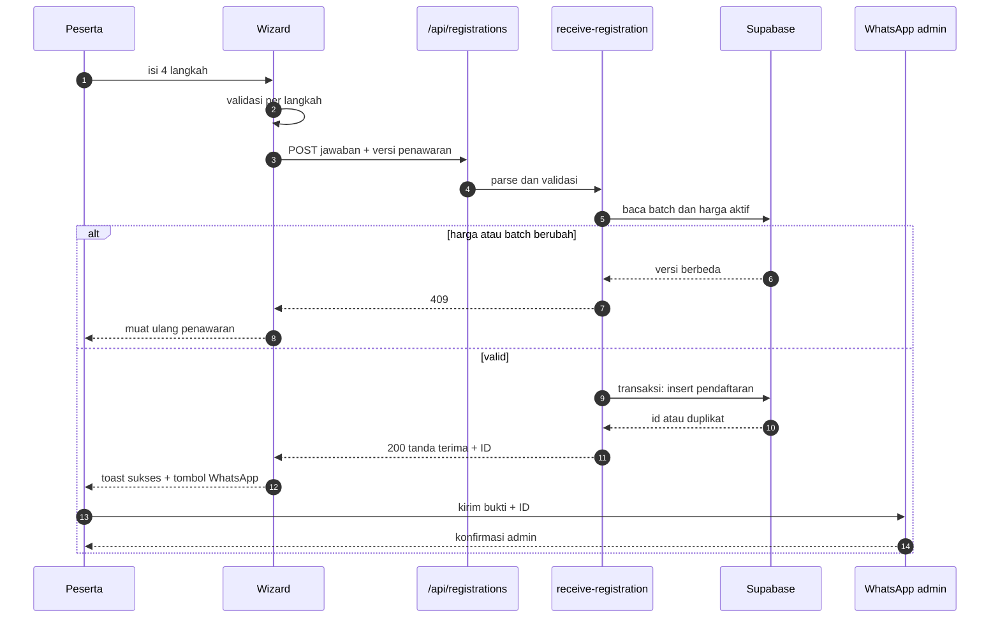

# Alur sistem Albana

Dokumen ini merangkum alur **frontend pendaftaran** dan **backend admin** dari [rencana implementasi 11 November 2026](../plans/2026-11-11-admin-program-batch-article-registration.md). Diagram memakai Mermaid, sehingga tampil di Obsidian dan GitHub.

Beberapa langkah adalah **target rencana** dan belum ada di checkout saat ini: `POST /api/registrations`, tampilan rekening di wizard, tombol bukti WhatsApp, editor blok artikel, dan aksi verifikasi di admin. Status tiap bagian dicatat di [§7](#7-status-implementasi).

## 1. Peta alur

Satu sumber data: admin menulis ke Supabase, lalu katalog publik dan halaman register membaca data yang sama. Tidak ada data contoh terpisah untuk kartu program.

## 2. Frontend registrasi

### 2.1 Titik masuk

- Kartu di beranda (`/#program-pilihan`) dan halaman detail `/program/[slug]`.
- Menu atau footer ke `/register`, lalu peserta memilih kelas.
- Tautan langsung `/register/[program]`, termasuk slug lama yang dipetakan ke slug kanonis.

Batch **tidak** dipilih lewat URL. Server memilih batch yang menerima pendaftaran: varian harus cocok, batch terbuka, dan sesi awal terdekat. Peserta melihat batch terpilih pada ringkasan sebelum mulai mengisi.

### 2.2 Wizard empat langkah

Peserta yang sudah login dapat memperoleh isian awal identitas dari profil member, tetapi login tidak wajib. Semua jawaban tetap dapat dikoreksi dan disimpan pada pendaftaran kelas, bukan pada profil.

| Langkah | Inti isian | Catatan |
|---|---|---|
| 1 · Data diri | Nama, panggilan, domisili, WA, email, jenis kelamin, usia, profesi, instansi | Instansi menerima “Tidak ada”; sosial media opsional di akhir bagian |
| 2 · Latar belakang | Pernah mengikuti pelatihan, tujuan, tantangan | Redaksi mengikuti varian `series` / `exclusive` |
| 3 · Informasi teknis | Sumber informasi, kesediaan hadir | Jadwal aktual tampil di atas pilihan hadir |
| 4 · Pembayaran | Lunas / DP 20%, rekening tujuan, instruksi WhatsApp | Nominal dihitung ulang di server sebelum simpan; tidak ada unggah file |

Galat spesifik tampil di bawah field yang salah, galat umum di atas field pertama, dan sukses memakai toast.

### 2.3 Pembayaran dan tanda terima

- Rekening tujuan ditampilkan sebelum tombol kirim, dengan aksi salin nomor.
- Bukti **tidak diunggah** di aplikasi. Bukti dikirim ke WhatsApp admin Albana (**0857-1779-7637**, `wa.me/6285717797637`) setelah tanda terima.
- Tanda terima menampilkan ID pendaftaran dan tombol “Kirim bukti via WhatsApp” dengan pesan terisi (ID, nama, program/batch, metode, nominal).
- Admin mencocokkan ID pada pesan dengan rekap, lalu menandai terverifikasi. Status “menunggu verifikasi” berarti bukti belum diperiksa.

## 3. Backend admin · program dan batch

Operator masuk ke shell admin lewat guard `requireAdminMember()`. Semua halaman admin berbagi topbar, sidebar, dan area konten yang sama.

Alur target: **Program (dua statis) → Tambah batch → Periksa jadwal & biaya → Buka pendaftaran**. Operator tidak memilih program dua kali dan tidak membuat program baru.

Aturan buka yang sama dipakai tombol admin, kartu beranda, detail program, dan halaman register. Batch tertutup tidak boleh muncul sebagai penawaran yang bisa didaftari.

Program bersifat statis sampai ada kebutuhan CRUD. Form pendek (trainer, galeri, venue, partner) memakai modal; batch dan artikel memakai halaman.

## 4. Backend admin · artikel

Penulis menyusun artikel dalam blok, mempratinjau dengan renderer publik, lalu menyimpan draf atau menerbitkan.

Artikel lama tanpa blok tetap dibaca lewat renderer teks lama. Artikel yang dikembalikan ke draf hilang dari daftar dan URL publik.

## 5. Backend admin · pendaftar

Bukti transfer tidak disimpan di aplikasi. Admin mencocokkan pesan WhatsApp dengan ID pendaftaran di rekap. Rekap lama tanpa bukti tetap ditampilkan apa adanya.

## 6. Urutan kirim pendaftaran

Retry pengajuan yang sama mengembalikan tanda terima dan ID yang sama. Duplikat dari pengajuan lain tidak menimpa data atau membuka identitas pendaftar lama.

## 7. Status implementasi

| Bagian | Di checkout saat ini | Target rencana |
|---|---|---|
| Program & batch | Dua daftar dan dua dialog `CmsCollectionClient` terpisah | Dua program statis; batch dikelola dalam konteks program dengan sesi berurutan |
| Katalog publik | `catalog.ts` membaca relasi; beranda masih memakai `DUMMY_PROGRAM_CARDS` | Sumber statis dua program + batch dipakai beranda, detail, dan register |
| Wizard registrasi | 4 langkah; langkah bayar hanya metode + persetujuan | Rekening, salin nomor, sisa, instruksi WhatsApp, toast sukses |
| Intake | Form memanggil `POST /api/registrations`, handler belum ada | Handler + insert pendaftaran + ID untuk pesan WhatsApp |
| Artikel | `CmsCollectionClient` dengan textarea `body` | Halaman tulis/edit + editor blok + pembaca blok |
| Bukti transfer | Belum ada tampilan rekening/verifikasi | Dikirim lewat WhatsApp; admin menandai terverifikasi dari rekap |
| Form admin | Semua form di dialog generik | Modal untuk form pendek; halaman untuk batch dan artikel |

---

**Baca berikutnya:** [rencana implementasi](../plans/2026-11-11-admin-program-batch-article-registration.md) · [form 01 · Public Speaking Series](../../registration/forms/01-public-speaking-series.md) · [form 02 · Basic to Advance Eksklusif](../../registration/forms/02-speaker-training.md)
