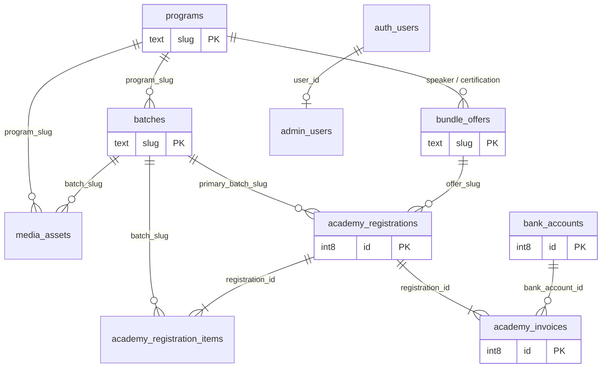

# Skema database — proyek Supabase `clgjsekfnexmanjdxmqy`

**Sumber:** katalog PostgreSQL proyek `clgjsekfnexmanjdxmqy` yang diperiksa kembali pada 15 November 2026, migrasi di `front/supabase/migrations/`, dan pemakaian di `front/`. [Referensi lama](database-reference.md) dan [`albana-schema.sql`](albana-schema.sql) adalah riwayat MVP 10 November. [Kontrol akses](access-control.md) masih merekam audit sebelum pembersihan dan perlu dibaca sebagai arsip.

Skema `public` kini berisi **18 tabel Albana** setelah [migrasi penghapusan tabel](../../../front/supabase/migrations/20261115143219_remove_community_schema.sql) dan [migrasi kolom](../../../front/supabase/migrations/20261115144057_remove_unused_albana_columns.sql) diterapkan ke proyek tersebut. Jumlah baris di bawah adalah cuplikan pemeriksaan, bukan penghitung langsung. Alur komunitas lama dipensiunkan oleh daftar rute Albana di `front/lib/albana-routes.ts`.

## 1. Peta tabel

| Kelompok | Tabel | Baris | Peran |
| --- | --- | ---: | --- |
| Katalog | `programs` | 4 | Program dan pertanyaan formulir. |
| | `batches` | 2 | Jadwal, harga, dan status pendaftaran. |
| | `trainers` | 4 | Profil pelatih; tidak berelasi langsung dengan batch. |
| | `bundle_offers` | 0 | Penawaran dua program. |
| Pendaftaran & tagihan | `academy_registrations` | 0 | Data pendaftar dan snapshot harga. |
| | `academy_registration_items` | 0 | Batch dalam setiap pendaftaran. |
| | `academy_invoices` | 0 | Tagihan awal dan pelunasan. |
| | `academy_intake_limits` | 0 | Pembatas laju penerimaan. |
| | `bank_accounts` | 0 | Rekening penerima; indeks `bank_accounts_one_active` menjaga maksimal satu rekening aktif. |
| Konten | `articles` | 4 | Artikel. |
| | `gallery` | 2 | Dokumentasi beranda. |
| | `media_assets` | 0 | Media program/batch. |
| | `testimonials` | 0 | Kutipan peserta. |
| | `academy_partners` | 0 | Mitra akademi. |
| | `contact_channels` | 4 | Kontak publik. |
| | `academy` | 1 | Profil akademi (baris id = 1). |
| Admin | `admin_users` | 1 | Daftar admin untuk RLS. |
| | `system_settings` | 0 | Pengaturan CMS dan batas resolusi media. |

## 2. Diagram relasi (tabel aktif)

Diagram hanya menampilkan relasi inti Albana. `trainers` sengaja tidak berelasi dengan `batches`. Testimoni menyimpan atribusi mandiri tanpa FK ke profil komunitas.

## 3. Katalog

### `programs` — PK `slug`

| Kolom | Tipe | Aturan |
| --- | --- | --- |
| `slug` | text | Pola `^[a-z0-9]+(-[a-z0-9]+)*$`; dibuat otomatis saat insert. |
| `title` | text | Wajib, tidak kosong. |
| `price_idr` | int8 | Wajib, ≥ 0. Nilai 0 berarti belum ada harga. |
| `original_price_idr` | int8 | Harga coret, opsional. |
| `description` | text | Opsional. |
| `materials` | jsonb | Larik materi; bawaan `[]`. |
| `form_prior_experience`, `form_goal`, `form_challenge` | text | Naskah pertanyaan formulir per program. |

Tidak ada kolom `published`: **semua program terbaca publik**. Program tanpa batch tampil tanpa tombol daftar.

### `batches` — PK `slug`, FK `program_slug → programs`

| Kolom | Tipe | Aturan |
| --- | --- | --- |
| `slug` | text | Pola slug; otomatis saat insert. |
| `program_slug` | text | Wajib. Ikut berubah bila slug program diubah (trigger). |
| `title` | text | Wajib. |
| `sessions` | jsonb | Wajib; divalidasi `valid_session_schedule()`. |
| `registration_open` | bool | Bawaan `false`. |
| `is_active` | bool | Bawaan `false`; **maksimal satu aktif per program**. |
| `venue`, `address` | text | Opsional. |
| `price_idr`, `normal_price_idr` | int8 | Opsional, ≥ 0. Mengganti harga program bila terisi. |
| `fee_details` | text | Opsional. |
| `form_kind` | text | `series` \| `exclusive` \| `bnsp`. |
| `dp_percent` | int2 | 1–99; `NULL` berarti tanpa pilihan DP. |

### `trainers` — PK `slug`

`name` (wajib), `bio`, `expertise` (text[]), `photo_url`. Slug otomatis. Editor CMS generik di `cms-fields.ts` masih menyebut `role` dan `published`, tetapi kedua kolom itu **tidak ada** pada tabel aktual. Gunakan editor trainer yang sesuai skema sampai editor generik dibetulkan.

### `bundle_offers` — PK `slug`

| Kolom | Tipe | Aturan |
| --- | --- | --- |
| `title` | text | Wajib. |
| `speaker_program_slug`, `certification_program_slug` | text | FK ke `programs`. |
| `price_idr` | int8 | `NULL` atau > 0. |
| `dp_percent` | int2 | 1–99. |
| `active` | bool | Bawaan `false`. |
| `description` | text | Penjelasan isi paket untuk peserta. |
| `show_on_speaker`, `show_on_certification` | bool | Radio tampil dari masing-masing program; dapat berbeda. |
| `placement_scope` | text | `program` saat ini; `batch` disiapkan tetapi belum diterima alur pendaftaran. |
| `speaker_batch_slug`, `certification_batch_slug` | text | FK batch, wajib bersama hanya untuk scope `batch`. |
| `updated_at` | timestamptz | |

Terbaca publik hanya bila `active AND price_idr IS NOT NULL`.

## 4. Pendaftaran dan tagihan

### `academy_registrations` — PK `id` (int8)

| Kolom | Tipe | Aturan |
| --- | --- | --- |
| `primary_batch_slug` | text | FK `batches`. |
| `offer_slug` | text | FK `bundle_offers`; `NULL` untuk pendaftaran tunggal. |
| `offer_title` | text | Snapshot nama program atau bundling. |
| `full_name`, `whatsapp` | text | Wajib. |
| `email` | text | Wajib; huruf kecil dan sudah di-trim. |
| `answers` | jsonb | Jawaban formulir (nama panggilan, domisili, usia, profesi, tujuan, tantangan, sumber, kesediaan hadir, …). |
| `payment_method` | text | `full` \| `dp`. |
| `price_idr_at_signup` | int8 | > 0; snapshot. |
| `dp_percent_at_signup` | int2 | 1–99; snapshot. |
| `idempotency_key` | uuid | **Unik.** |
| `submission_hash` | text | Hash isi kiriman. |
| `received_at` | timestamptz | Bawaan `now()`. |

### `academy_registration_items` — PK (`registration_id`, `batch_slug`)

Satu baris per batch yang diikuti. Pendaftaran tunggal punya satu baris; bundling punya dua.

### `academy_invoices` — PK `id` (int8)

| Kolom | Tipe | Aturan |
| --- | --- | --- |
| `registration_id` | int8 | FK. |
| `bank_account_id` | int8 | FK `bank_accounts`. |
| `stage` | text | `initial` \| `remaining`; unik bersama `registration_id`. |
| `subtotal_idr` | int8 | > 0. |
| `unique_code` | int2 | 1–999. |
| `total_idr` | int8 | Kolom turunan: `subtotal_idr + unique_code`. |
| `status` | text | `pending` \| `verified` \| `rejected` \| `cancelled`; bawaan `pending`. |
| `reviewed_by`, `reviewed_at` | text, timestamptz | Diisi saat keputusan. |
| `created_at` | timestamptz | |

Indeks unik parsial `academy_invoice_active_code (bank_account_id, unique_code) WHERE status = 'pending'`.

### `academy_intake_limits` — PK (`source_hash`, `window_start`)

Penghitung `attempts` per sumber per jendela waktu untuk pembatasan laju.

### `bank_accounts` — PK `id` (int8)

`bank`, `account_number`, `holder` (wajib), `active` (bawaan `false`). Indeks unik parsial `bank_accounts_one_active ((true)) WHERE active` memastikan tepat satu rekening aktif. RPC penerimaan memerlukan satu rekening aktif.

## 5. Konten

### `articles` — PK `slug`

`title`, `body` (wajib), `excerpt`, `body_blocks` (jsonb, harus larik), `published` (bawaan `false`), `published_at`, `updated_at`. `body` dan `body_blocks` saat ini melayani jalur editor yang berbeda; satukan kontrak editor dan renderer sebelum memilih satu representasi isi.

### `gallery` — PK `id` (int8)

`title` (opsional), `image_url` (wajib, harus `https://`), `consent_at` (bawaan `now()`). Tanpa kolom terbit: semua baris tampil publik. Editor CMS generik di kode memakai nama `asset_url`, `alt_text`, `caption`, `sort_order`, dan `published`; **jangan hapus atau ganti kolom `image_url` berdasarkan form itu**. Selaraskan form dengan skema dan pembaca publik terlebih dahulu.

### `media_assets` — PK `id` (int8)

| Kolom | Tipe | Aturan |
| --- | --- | --- |
| `provider` | text | `supabase_storage` \| `cloudinary` \| `youtube`. |
| `kind` | text | `image` \| `video`. |
| `object_key` | text | Unik bersama `provider`. |
| `alt_text` | text | |
| `consent_at` | timestamptz | |
| `published` | bool | Bawaan `false`. |
| `program_slug`, `batch_slug` | text | FK opsional; menentukan halaman tempat aset tampil. |
| `created_at` | timestamptz | |

### `testimonials` — PK `id` (int8)

`attribution` (wajib; diisi langsung dari CMS), `quote` (wajib, **20–30 kata**), `role_label`, `consent_at`, `published` (bawaan `true`), `photo_url`. FK profil komunitas dan kolom penanda/urutan yang tidak dipakai sudah dihapus.

### `academy_partners` — PK `id` (int8)

`name` (1–160 karakter), `logo_url`, `sort_order`, `published` (bawaan `false`).

### `contact_channels` — PK `kind`

`kind` ∈ `address` \| `instagram` \| `whatsapp` \| `email`; `value` wajib. Tepat satu baris per jenis.

### `academy` — PK `id` (selalu 1)

`name`, `teaching_method`, `reschedule_policy`. Tabel satu baris; baris `id = 1` telah terisi profil Albana Speech Academy. Sidebar admin kini ditentukan oleh kode, sehingga kolom pengaturan sidebar lama dihapus.

## 6. Admin dan pengaturan

### `admin_users` — PK `user_id` → `auth.users`

`role` ∈ `admin` | `adminsuper` (bawaan `admin`), `created_at`. Keanggotaan tabel ini adalah syarat semua kebijakan tulis CMS.

### `system_settings` — PK `key`

Pasangan `key`/`value` teks. Kunci yang dibaca Albana: `albana_media_min_image_width`, `albana_media_min_image_height`, `albana_media_min_video_short_side`.

## 7. Fungsi dan trigger Albana

| Fungsi | Jenis | Dipanggil oleh | Guna |
| --- | --- | --- | --- |
| `receive_academy_registration(request jsonb) → jsonb` | invoker | service role | Menerima pendaftaran dan membuat tagihan awal dalam satu transaksi. |
| `resolve_academy_invoice(target_invoice_id, decision, reviewer) → jsonb` | invoker | service role | Verifikasi/tolak tagihan; membuat tagihan pelunasan bila perlu. |
| `valid_session_schedule(schedule jsonb) → bool` | invoker | constraint | Validasi `batches.sessions`. |
| `set_catalog_slug()` | trigger | BEFORE INSERT pada `programs`, `batches`, `trainers`, `articles` | Membuat slug dari judul/nama. |
| `sync_program_slug()` | trigger | BEFORE UPDATE `programs` | Menyebarkan perubahan slug ke tabel anak. |
| `enforce_single_active_batch()` | trigger, definer | BEFORE INSERT/UPDATE `batches` | Menonaktifkan batch lain saat satu diaktifkan. Izin panggil langsung lewat REST dicabut dari `public`, `anon`, `authenticated`. |
| `reactivate_old_program_batch()` | trigger, definer | AFTER UPDATE `batches` | Menjaga program asal saat batch dipindah. Izin panggil langsung lewat REST dicabut dari `public`, `anon`, `authenticated`. |

## 8. Storage

| Bucket | Publik | Batas ukuran | MIME |
| --- | --- | --- | --- |
| `academy-media` | Tidak | 25 MiB | JPEG, PNG, WebP, MP4, WebM |
| `gallery` | Ya | — | — |
| `testimonials` | Ya | 5 MiB | JPEG, PNG, WebP |

## 9. Hasil pembersihan dan batasnya

- **Tabel:** 22 tabel komunitas/transisi dihapus dari `public`, termasuk profil member, alur pendaftaran lama, pengaturan role lama, transaksi komunitas, serta katalog komunitas. Migrasi menolak penghapusan bila tabel transaksi lama yang semula kosong tiba-tiba berisi data atau bila terdapat member selain admin.
- **Kolom:** `testimonials.member_id`, `academy.hidden_admin_modules`, `testimonials.result_highlight`, `testimonials.is_featured`, dan `testimonials.order_index` dihapus. Testimoni sekarang menyimpan nama pemberi secara mandiri. Kolom lain dipertahankan karena dipakai katalog, formulir, penagihan, konten, atau audit.
- **Akses:** `admin_users` menjadi sumber otorisasi CMS; daftar rute publik/admin Albana ada di `front/lib/albana-routes.ts`. Rute komunitas lama yang berkasnya masih ada akan merespons 404 melalui proxy dan harus dihapus dari repo pada pembersihan kode berikutnya.
- **Selisih CMS lama:** `cms-fields.ts` masih berisi field generik yang tidak cocok dengan tabel aktual, terutama `programs.published`, `trainers.role`/`published`, dan `gallery.asset_url`. Halaman khusus yang aktif memakai kolom aktual. Jangan menerapkan editor generik tersebut sebelum kontraknya diselaraskan.
- **Riwayat migrasi:** Supabase mencatat versi `20261115143219`, `20261115144057`, dan `20261116_albana_admin_rules` (indeks rekening aktif, seed profil akademi, pencabutan izin eksekusi trigger definer); nama file lokal memakai versi yang sama. [Kontrol akses](access-control.md) belum diaudit ulang sesudah perubahan sehingga angka dan catatan warisannya tidak boleh dipakai sebagai status terkini.

## 10. Ekstensi

`pgcrypto` 1.3, `uuid-ossp` 1.1, `pg_stat_statements` 1.11, `supabase_vault` 0.3.1.

## 11. Konvensi

- **Kunci.** Katalog memakai slug teks sebagai PK agar URL stabil; data transaksi memakai `int8` identitas. Perubahan slug harus melalui mekanisme sinkronisasi FK yang ada.
- **Uang.** Rupiah utuh dalam `int8` dengan akhiran `_idr`. Jangan menambah kolom `numeric` baru.
- **Waktu.** `timestamptz`; tampil dalam WIB di antarmuka.
- **Pilihan terbatas.** `text` + `CHECK`, bukan tipe `ENUM` (tidak ada enum di skema `public`).
- **Status terbit.** Sebagian tabel konten memakai `published`; `programs` dan `gallery` belum memiliki kolom tersebut, sehingga pembacaan publiknya tidak disaring dengan status terbit.
- **Snapshot.** Nilai yang memengaruhi tagihan disalin ke baris pendaftaran dengan akhiran `_at_signup`.
- **Perubahan skema.** Hanya lewat migrasi bernama; lihat [lingkungan dan operasi](../project/environment-setup.md#4-migrasi-database).
