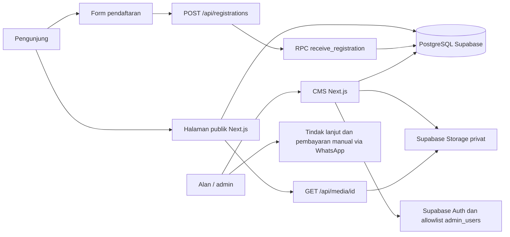

# Arsitektur sistem — Albana Speech Academy

**Untuk MVP**, ikuti [enam menu dan alur pendaftaran](../registration/registration-contract.md) serta [skema akademi](./albana-schema.sql). Peta rute dan modul di bawah merekam arsitektur dev sebelum penyederhanaan.

**Status: 10 November 2026.** Dokumen ini memisahkan implementasi dev dari struktur tujuan. Bagian admin memakai satu folder rute bernama untuk setiap modul, seperti `admin/trainer/page.tsx` dan `admin/gallery/page.tsx`; keduanya sudah dibuat. Albana tetap **satu situs kelas** dengan CMS internal, tanpa subdomain komunitas, akun peserta, atau sistem membership.

## 1. Tujuan dan sumber keputusan

Pengunjung perlu memahami program, trainer, jadwal, dokumentasi, dan artikel; kemudian mengirim pendaftaran. Alur yang dituju: Alan/admin mengelola konten dan menindaklanjuti pembayaran secara manual; materi kelas dibagikan lewat WhatsApp. Buku, kursus online, bot, pembayaran otomatis, dan sertifikasi sebagai produk awal berada di luar cakupan [brief](../project/project-brief.md).

Gunakan [brief](../project/project-brief.md) untuk cakupan bisnis, [konten beranda](../content/home-page-content.md) untuk naskah dan status pratinjau, [desain](../design/visual-design.md) untuk antarmuka, serta [model data](./database-reference.md) dan SQL di `web/db/` untuk aturan data yang sedang diterapkan. [Rancangan teknis awal](../archive/legacy/technical-plan.md) masih menyebut MySQL/Prisma dan Cloudinary; implementasi dev sekarang memakai PostgreSQL, Auth, dan Storage Supabase. Pilihan database dan media untuk hosting akhir belum diputuskan. Kode aplikasi dan skema SQL adalah bukti implementasi, bukan bukti bahwa layanan produksi sudah aktif.

## 2. Peta sistem



Satu aplikasi Next.js App Router melayani halaman publik, CMS, dan Route Handler. Tidak ada layanan API terpisah. Server Components membaca data publik; komponen client menangani interaksi formulir, menu, dialog, dan editor. Modul `lib/server/` menyimpan akses ke Supabase dan tidak boleh diimpor ke komponen client. Data publik boleh dibaca sesuai kebijakan RLS; data pendaftaran, rekening, dan pembayaran tetap privat.

### Stack dan status

| Lapisan | Kondisi aplikasi dev | Keputusan lanjutan |
| --- | --- | --- |
| Aplikasi | Next.js 16 App Router, React 19, TypeScript | Pertahankan satu aplikasi `web/`. |
| Antarmuka | Tailwind CSS 4 dan token di `app/globals.css` | Ikuti [desain](../design/visual-design.md); jangan membangun UI kit tambahan tanpa kebutuhan. |
| Data | PostgreSQL Supabase; akses REST dan RPC melalui `fetch`; SQL di `web/db/` | Operasi hosting akhir, backup, dan pemulihan perlu ditetapkan. Prisma/MySQL belum terpasang. |
| Admin | Supabase Auth password, cookie HTTP-only, allowlist `admin_users`, RLS | Perlu uji alur di hosting dan pembatasan percobaan login. Auth.js tidak terpasang. |
| Media | Bucket Supabase Storage privat, metadata di `media_assets`, URL bertanda tangan; tautan YouTube didukung | Cloudinary adalah rancangan lama, bukan penyimpanan aktif. Uji unggah dan siklus terbit sebelum produksi. |
| Hosting | Target bisnis Hostinger pada [brief](../project/project-brief.md) | Paket Node.js, domain, deployment, koneksi Supabase, dan rencana migrasi belum diverifikasi. |

## 3. Rute dan hak akses

| Rute                                                                  | Akses                          | Fungsi dan status                                                                                                           |
| --------------------------------------------------------------------- | ------------------------------ | --------------------------------------------------------------------------------------------------------------------------- |
| `/`                                                                   | Publik                         | Beranda, program, jadwal, trainer, dokumentasi, testimoni, dan kontak. Contoh pratinjau harus tetap diberi label.           |
| `/program/[slug]`                                                     | Publik                         | Detail program terbit; slug tidak dikenal menjadi 404.                                                                      |
| `/register`, `/register/[program]`                                    | Publik                         | Pemilihan program dan formulir; batch yang menerima dipilih di server dari slug program.                                    |
| `/register/preview`                                                   | Publik, pratinjau              | Contoh alur, bukan pendaftaran nyata.                                                                                       |
| `/artikel`, `/artikel/[slug]`                                         | Publik                         | Daftar dan isi artikel yang diterbitkan; keadaan kosong/gagal tersedia.                                                     |
| `/login`                                                              | Publik                         | Login admin di group `(auth)`; bukan login peserta.                                                                         |
| `/admin`, `/admin/<modul>`                                            | Admin                          | **Ada:** ringkasan dan rute bernama per modul; daftar serta detail memakai endpoint CMS yang sama. `/admin/konten/[table]` lama dialihkan. |
| `GET /api/catalog`                                                    | Publik                         | Katalog terbit, `Cache-Control: no-store`; gagal memberi 503.                                                               |
| `POST /api/registrations`                                             | Publik                         | Validasi isian dan persetujuan, lalu RPC penerimaan.                                                                        |
| `GET /api/media/[id]`                                                 | Publik                         | Mengarahkan aset yang boleh dibaca ke URL media bertanda tangan/YouTube.                                                    |
| `POST /api/admin/login`                                               | Publik                         | Memvalidasi kredensial dan allowlist sebelum membuat sesi admin.                                                            |
| `/api/admin/logout`, `/api/admin/content/[table]`, `/api/admin/media` | Admin pada operasi terlindungi | Mengakhiri sesi, membaca/mengubah/menghapus konten, dan mengunggah media. Periksa otorisasi pada setiap handler, bukan hanya halaman. |

Belum ada rute peserta, checkout, payment gateway, atau panel verifikasi pembayaran yang lengkap. `/register` adalah pendaftaran **kelas**, bukan pembuatan akun.

### Menu CMS dan rute tujuan

Rute di bawah adalah **struktur yang sudah dipasang**. Nama folder memakai huruf kecil dan kebab-case sesuai konvensi Next.js; label menu tetap berbahasa Indonesia. Setiap `page.tsx` memiliki satu urusan yang mudah ditemukan. Halaman memakai validasi, query, dan endpoint CMS yang sudah ada; pemisahan rute tidak membuat API baru untuk setiap tabel.

| Kelompok menu | Halaman tujuan | Data yang dikelola | Status |
| --- | --- | --- | --- |
| Ringkasan | `/admin` | Tautan ke modul; bukan statistik yang belum tersedia | Ada |
| Profil akademi | `/admin/profil-akademi` | `academy`: nama, metode, kebijakan | Ada |
| Program | `/admin/program` | `programs` | Ada |
| Trainer | `/admin/trainer` | `trainers` | Ada |
| Jadwal kelas | `/admin/batch`, `/admin/sesi`, `/admin/penugasan-trainer` | `batches`, `sessions`, `batch_trainers` | Ada |
| Dokumentasi | `/admin/gallery`, `/admin/testimoni` | `gallery`, `testimonials` | Ada |
| Publikasi | `/admin/artikel`, `/admin/media` | `articles`, `media_assets` | Ada |
| Kontak & rekening | `/admin/pengaturan` | `contact_channels`, `bank_accounts` (internal); satu halaman dengan tab lokal | Ada |
| Operasional | `/admin/pendaftaran`, `/admin/pembayaran` | Tindak lanjut `registrations` dan verifikasi `payments` | Direncanakan; alur admin belum lengkap |

`/login` adalah halaman masuk di group `(auth)`, di luar shell CMS; halaman autentikasi lain dapat ditambahkan di group yang sama. URL lama `/admin/konten/[table]` dialihkan ke rute bernama agar bookmark admin tidak putus; tabel tak dikenal menjadi 404. Kontak dan rekening berada di satu halaman `/admin/pengaturan`; tab Kontak/Rekening dikelola sebagai state komponen, jadi berpindah tab tidak memuat ulang halaman atau mengubah URL. Halaman ini menyembunyikan sidebar agar formulir lebih lebar. Daftar dan detail modul lain dibuka sebagai halaman terpisah. Jangan menampilkan data pendaftaran atau rekening pada halaman publik.

## 4. Alur utama dan batas kepercayaan

### Konten publik

CMS menyimpan konten sebagai draf atau terbit. Skema/RLS hanya mengizinkan bacaan publik untuk baris yang memenuhi syarat terbit, termasuk persetujuan untuk galeri, testimoni, potret, dan aset media. Pembaca publik mengambil katalog, artikel, dan kanal kontak melalui modul server. Artikel Markdown harus dirender aman. Jangan menyalin data contoh, kredensial, atau konten tanpa izin menjadi konten terbit.

### Pendaftaran kelas

1. Pengunjung membuka detail program atau formulir. Server memilih batch yang masih menerima pendaftaran; jika tidak ada, tampilkan keadaan tidak tersedia, bukan form aktif.
2. Client mengirim JSON ke `POST /api/registrations`. Handler membatasi ukuran dan jenis request. `lib/registration-input.ts` memvalidasi data serta persetujuan.
3. `lib/server/receive-registration.ts` memanggil RPC `public.receive_registration` memakai kunci intake server. RPC mengunci batch, memeriksa ulang kelayakan dan rincian biaya/DP, menangani duplikasi serta batas laju, lalu menyimpan tanda terima.
4. Respons berhasil berarti **form diterima**, bukan kursi atau pembayaran terkonfirmasi. Respons perubahan batch, batch tutup, batas laju, dan gangguan layanan harus tetap dibedakan agar pengguna dapat memperbaiki atau mencoba lagi.
5. Admin menindaklanjuti lewat WhatsApp. Pencatatan/verifikasi pembayaran dan perpindahan batch sesuai aturan bisnis masih memerlukan implementasi operasional; jangan menggambarkan status ini sebagai otomatis.

### Login dan CMS

`POST /api/admin/login` memvalidasi kredensial, meminta sesi ke Supabase Auth, lalu mengecek `admin_users` sebelum menyimpan cookie akses HTTP-only. Halaman dan handler admin memeriksa kembali sesi serta allowlist. Editor memakai definisi koleksi di `lib/cms-fields.ts`, validasi di `lib/cms-validation.ts`, dan akses REST ber-token di `lib/server/cms-data.ts`; rute admin bernama memakai aturan yang sama. RLS tetap menjadi pagar di database. Unggahan admin diperiksa tipe/ukuran, disimpan sebagai draf di bucket privat, lalu dicatat di `media_assets`. URL bertanda tangan untuk media publik berumur pendek.

## 5. Data dan invariannya

| Kelompok | Tabel saat ini | Aturan utama |
| --- | --- | --- |
| Akademi dan katalog | `academy`, `programs`, `trainers`, `batches`, `sessions`, `batch_trainers` | Publik hanya melihat program/konten yang layak terbit. Batch menerima pendaftaran bila rincian wajib dan sesi valid tersedia; kapasitas non-NULL belum diaktifkan sebelum aturan kuota disahkan. |
| Editorial | `gallery`, `testimonials`, `articles`, `contact_channels`, `media_assets` | Publikasi galeri, testimoni, potret, dan media mensyaratkan izin; artikel hanya terlihat saat terbit. |
| Operasional privat | `admin_users`, `bank_accounts`, `registrations`, `payments`, `intake_key` | Akses admin dibatasi allowlist dan RLS; data peserta, rekening, dan pembayaran tidak tersedia bagi pengunjung. |

Nominal disimpan sebagai `numeric(12,0)` rupiah; waktu sebagai `timestamptz`, ditampilkan dalam WIB. Pendaftaran menyimpan snapshot harga, rincian biaya, dan DP pada saat kirim sehingga perubahan batch berikutnya tidak menulis ulang riwayat. Rincian kolom, kebijakan akses, dan SQL terpasang dijelaskan di [model data](./database-reference.md). Bukti pembayaran saat ini ditindaklanjuti lewat WhatsApp admin, bukan unggahan peserta ke situs.

## 6. Struktur folder dan kepemilikan

### Kondisi admin saat ini

```text
web/app/
├── (admin)/admin/
│   ├── page.tsx                    # ringkasan dan tautan modul
│   ├── loading.tsx                 # skeleton area konten (sidebar/topbar tetap)
│   ├── layout.tsx                  # sesi + allowlist + shell admin
│   ├── profil-akademi/             # page.tsx + [key]/page.tsx
│   ├── program/
│   ├── trainer/
│   ├── batch/
│   ├── sesi/
│   ├── penugasan-trainer/
│   ├── gallery/
│   ├── testimoni/
│   ├── artikel/
│   ├── media/                      # daftar disertai form unggah
│   ├── kontak/
│   ├── rekening/
│   └── konten/[table]/             # redirect URL lama ke rute bernama
├── (auth)/                         # autentikasi, di luar shell admin
│   └── login/page.tsx
└── (web)/                          # halaman publik
    ├── page.tsx                    # beranda
    ├── artikel/
    ├── program/
    └── register/
```

Route group `(admin)`, `(auth)`, dan `(web)` tidak muncul di URL. Shell admin dipasang sekali di `app/(admin)/admin/layout.tsx` melalui `AdminModuleLayout` (`components/admin/admin-module-layout.tsx`): komponen itu memeriksa sesi + allowlist lalu membungkus halaman dengan sidebar/topbar. Karena `loading.tsx` berada di bawah layout itu, skeleton hanya mengisi area konten dan sidebar/topbar tidak ikut berkedip. `/login` berada di group `(auth)` agar halaman autentikasi lain (misalnya lupa kata sandi) bisa ditambahkan tanpa memakai shell. Setiap modul punya halaman daftar dan halaman detail/create terpisah. Definisi koleksi ada di `web/lib/cms-fields.ts`; pemetaan modul ke URL ada di `web/lib/admin-modules.ts`. `pendaftaran` dan `pembayaran` belum dibuat.

### Struktur tujuan yang mudah dibaca

Pohon ini hanya memuat kebutuhan Albana. Baris bertanda **rencana** belum ada di kode. Jangan membuat folder kosong; buat halaman ketika modul tersebut benar-benar dikerjakan. Nama `[table]` adalah segmen dinamis Next.js, bukan nama modul bisnis.

```text
project/
├── AGENTS.md
├── docs/
│   ├── project/project-brief.md                   # cakupan produk
│   ├── data/database-reference.md                # model data dan aturan akses
│   ├── design/visual-design.md                  # desain antarmuka
│   ├── archive/legacy/technical-plan.md                    # rancangan teknis awal
│   ├── content/home-page-content.md  # naskah dan status publikasi
│   └── data/system-architecture.md     # peta sistem dan struktur tujuan
└── web/                           # satu aplikasi; batas npm dan package-lock.json
    ├── AGENTS.md
    ├── app/
    │   ├── layout.tsx              # root layout publik
    │   ├── globals.css
    │   ├── (web)/                  # halaman publik
    │   │   ├── page.tsx            # beranda
    │   │   ├── program/[slug]/page.tsx # detail program publik
    │   │   ├── register/           # pemilihan, [program], preview
    │   │   └── artikel/            # daftar dan [slug]
    │   ├── (admin)/admin/          # halaman CMS, di bawah /admin
    │   │   ├── page.tsx            # ringkasan; sudah ada
    │   │   ├── loading.tsx         # skeleton segmen admin
    │   │   ├── profil-akademi/     # layout + daftar + [key]; sudah ada
    │   │   ├── program/
    │   │   ├── trainer/
    │   │   ├── batch/
    │   │   ├── sesi/
    │   │   ├── penugasan-trainer/
    │   │   ├── gallery/
    │   │   ├── testimoni/
    │   │   ├── artikel/
    │   │   ├── media/
    │   │   ├── kontak/
    │   │   ├── rekening/
    │   │   ├── konten/[table]/     # redirect URL lama
    │   │   ├── pendaftaran/        # rencana: tindak lanjut pendaftar
    │   │   └── pembayaran/         # rencana: verifikasi manual
    │   ├── (auth)/
    │   │   └── login/page.tsx      # login; di luar shell
    │   └── api/
    │       ├── catalog/route.ts
    │       ├── registrations/route.ts
    │       ├── media/[id]/route.ts
    │       └── admin/             # login, logout, content/[table], media
    ├── components/
    │   ├── home/                  # seksi beranda
    │   ├── program/               # detail program
    │   ├── register/              # alur dan form pendaftaran
    │   ├── registration/          # tampilan batch
    │   ├── article/               # isi artikel
    │   ├── admin/                 # komponen admin; pecah per modul bila perlu
    │   ├── layout/                # header, footer, container
    │   └── ui/                    # kontrol tanpa aturan domain
    ├── lib/
    │   ├── server/                # query, mutasi, auth, koneksi provider
    │   └── *.ts                   # aturan, validasi, format; tes terkolokasi
    ├── db/                        # SQL skema, kebijakan, dan verifikasi
    └── public/                    # aset statis yang aman untuk publik
```

Rute hanya menghubungkan batas framework dan menyusun layar. Komponen mengurus tampilan/interaksi. `lib/` menampung aturan dan validasi; `lib/server/` menampung I/O dan rahasia server. Setiap halaman admin selain login memanggil pemeriksaan sesi/allowlist di server; setiap Route Handler terlindungi tetap memvalidasi sesi dan izin sendiri. Jika fitur pembayaran manual atau riwayat reschedule dibangun, letakkan aturan dan I/O pada `lib/`, `lib/server/`, dan `db/` sesuai tanggung jawabnya. Jangan membuat `src/app/` kedua atau layanan backend baru.

Migrasi editor generik ke rute bernama sudah selesai: `/admin/konten/[table]` kini hanya mengalihkan URL lama. Modul baru mengikuti pola yang sama—tambahkan entri di `web/lib/admin-modules.ts`, lalu halaman daftar dan `[key]`—tanpa membuat endpoint per tabel atau `layout.tsx` per modul. Pendaftaran dan pembayaran memerlukan alur serta otorisasi tersendiri sebelum halamannya diaktifkan.

## 7. Keamanan dan operasi sebelum produksi

- Validasi parameter URL, form, respons provider, dan unggahan di server. Gunakan token server hanya pada server; permintaan publik tetap dibatasi grant dan RLS.
- Jaga draf, data peserta, rekening, dan pembayaran dari cache publik. Publikasikan media/kutipan hanya dengan izin yang tercatat. Pertahankan nilai historis pendaftaran ketika data batch berubah.
- Verifikasi paket Hostinger yang mendukung aplikasi Next.js/Node, konektivitas ke Supabase, konfigurasi domain/HTTPS, environment variables, kapasitas unggahan, backup database dan Storage, serta uji pemulihan. Jangan menganggap target tenggat pada [rancangan teknis](../archive/legacy/technical-plan.md) sebagai bukti deployment.
- Sebelum rilis, uji login dan penolakan akun di luar allowlist, siklus draf–terbit–tarik, akses media, formulir valid/gagal/duplikat, serta tindak lanjut pembayaran manual. Pembatasan percobaan login dan pengujian browser unggahan menyeluruh masih terbuka menurut [model data](./database-reference.md).

## 8. Keputusan yang masih dibutuhkan

| Topik | Keputusan pemilik yang dibutuhkan | Dampak |
| --- | --- | --- |
| Batch nyata | Jadwal, lokasi, harga/rincian biaya, DP, dan kuota | Menentukan batch yang boleh dibuka dan teks formulir publik. |
| Pembayaran manual | Rekening aktif, instruksi, cara dan otorisasi verifikasi | Menentukan alur CMS dan kapan peserta terkonfirmasi. |
| Penjadwalan ulang | Batas waktu, syarat, dan cara memindahkan peserta | Menentukan validasi dan riwayat perubahan batch. |
| Publikasi | Izin setiap foto/video/kutipan, bio/kredensial, dan artikel awal | Menentukan konten yang dapat diterbitkan. |
| Operasi hosting | Paket/domain Hostinger, pilihan database/media akhir, backup dan pemulihan | Menentukan deployment atau kebutuhan migrasi yang aman. |
| Data pribadi | Kebijakan retensi dan prosedur penanganan data pendaftar | Menentukan operasional dan penghapusan yang sah. |

Sampai keputusan tersedia, pertahankan data sebagai draf atau keadaan kosong yang jelas. Jangan mengisi harga, kapasitas, izin, atau tanggal dari contoh formulir maupun dokumen referensi lain.
