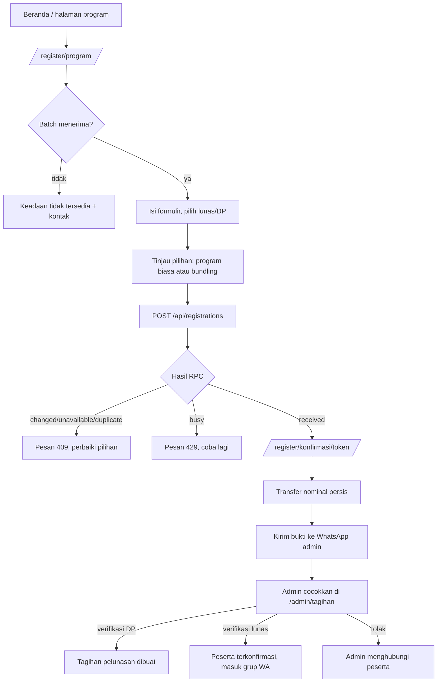

# PRD — Website Kelas dan CMS Albana Speech Academy

**Versi:** 1.1 · **Tanggal:** 16 November 2026 · **Proyek Supabase:** `clgjsekfnexmanjdxmqy`

Dokumen ini menyatukan [brief proyek](project-brief.md), [spesifikasi revisi](website-revision-specification.md), [proposal akademi](../content/academy-proposal.md), dan keadaan database yang dibaca langsung pada 15 November 2026. Bila ada pertentangan, urutan acuannya: spesifikasi revisi → PRD ini → brief. Proposal adalah sumber **isi** (profil lembaga, metode, trainer, kontak); spesifikasi revisi adalah sumber **struktur dan alur**.

**Perubahan 1.1:** menambah profil lembaga dan kebutuhan konten dari proposal (bagian 1.1 dan 6.4); menyelaraskan urutan beranda, bundling lewat editor Program, peninjauan pilihan sebelum checkout, dan rincian tagihan dengan spesifikasi revisi terbaru; menautkan [layout landing page](../design/academy-landing-layout.md) dan [pola UI admin](../design/admin-ui-patterns.md). Status tiap kebutuhan memakai tiga label: **Terpasang** (ada di kode dan database), **Sebagian** (ada, belum lengkap atau belum diuji), **Belum** (belum dikerjakan).

## 1. Ringkasan produk

Satu situs untuk Albana Speech Academy: calon peserta memahami program, melihat bukti (dokumentasi, testimoni, trainer), lalu mendaftar dan menerima tagihan transfer bank. Alan Albana dan admin mengelola seluruh konten, batch, serta verifikasi pembayaran melalui CMS tanpa bantuan pengembang.

| Aspek | Keputusan |
| --- | --- |
| Bentuk | Satu aplikasi Next.js: halaman publik + CMS `/admin` + Route Handler. |
| Data | PostgreSQL, Auth, dan Storage Supabase pada proyek `clgjsekfnexmanjdxmqy`. |
| Pembayaran | Transfer bank manual dengan kode unik; bukti dikirim lewat WhatsApp; admin memverifikasi. |
| Target | QA 16 November 2026; rilis 17 November 2026 pagi (bersyarat pada gerbang rilis). |

### 1.1 Profil lembaga (dari proposal)

| Butir | Isi |
| --- | --- |
| Lembaga | Albana Speech Academy by CV Asa Albana — pengembangan SDM yang berfokus pada kompetensi komunikasi profesional, berbasis praktik. |
| Visi | Menjadi mitra terpercaya dalam pengembangan kompetensi komunikasi profesional dan kepemimpinan SDM yang berdaya saing tinggi. |
| Misi | Pelatihan komunikasi dari basic hingga advance; meningkatkan kepercayaan diri dan performa komunikasi; pelatihan berbasis praktik nyata; mendukung budaya komunikasi profesional di organisasi. |
| Bidang pelatihan | Public Speaking · Professional Presentation · MC & Event Communication · Moderator & Host Training · Leadership Communication · Service Excellence · Training of Trainer. |
| Kerangka pengembangan | Fundamental (Build Confidence) → Professional (Effective Communication) → Advance (Stage Performance) → Expert (Speaker & Facilitator). |
| Model belajar | 70% praktik dan simulasi · 20% coaching dan feedback · 10% konsep dan kerangka. |
| Hasil yang dituju | Komunikasi kerja lebih efektif; SDM lebih percaya diri; presentasi lebih meyakinkan; representasi organisasi lebih profesional. |
| Format | Public Training (jadwal dan kota sesuai penawaran) dan In House Training (lokasi, silabus, dan waktu menyesuaikan perusahaan). |
| Trainer | Alan Albana (founder), Nurachman, Andhan Indah, Abo Priatna. |
| Kontak | Jl. Diponegoro No. 61 Bandung · WhatsApp 0857-1779-7637 · asaalbana91@gmail.com · Instagram @albanaspeechacademy. |

Tujuh bidang pelatihan adalah **cakupan keahlian lembaga**, bukan tujuh program yang dijual. Yang dijual di situs adalah empat program pada bagian 5.

## 2. Masalah dan tujuan

**Masalah.** Pendaftaran berjalan lewat Google Form dan percakapan WhatsApp. Informasi program, jadwal, dan harga tersebar; tagihan dihitung manual; tidak ada satu tempat untuk melihat siapa sudah mendaftar dan siapa sudah membayar.

**Tujuan.**

1. Pengunjung dapat menilai program dan mendaftar dari ponsel tanpa bertanya dulu ke admin.
2. Setiap pendaftaran menghasilkan tagihan dengan nominal persis (subtotal + kode unik) dan rekening tujuan.
3. Admin dapat mencocokkan transfer dengan tagihan, lalu memverifikasi atau menolak dalam satu layar.
4. Alan dapat memperbarui program, batch, trainer, artikel, media, testimoni, partner, dan kontak sendiri.
5. Pengambil keputusan korporat dapat menilai kredibilitas lembaga (profil, metode, trainer, klien) dan memulai konsultasi In House dalam satu halaman.

**Ukuran keberhasilan.**

| Ukuran | Target awal |
| --- | --- |
| Pendaftaran selesai tanpa bantuan admin | ≥ 90% kiriman formulir berakhir di halaman konfirmasi. |
| Pencocokan pembayaran | Setiap transfer dapat dicocokkan dari nominal saja (kode unik tidak bentrok per rekening). |
| Kemandirian konten | Perubahan harga, jadwal, dan status pendaftaran dilakukan admin tanpa deploy. |
| Kebocoran data | Nol data pendaftar, rekening, atau tagihan yang dapat dibaca tanpa sesi admin. |

## 3. Pengguna

| Pengguna | Kebutuhan utama | Kanal |
| --- | --- | --- |
| Calon peserta (mahasiswa – profesional muda) | Manfaat, materi, trainer, harga, jadwal, cara daftar. Sebagian besar membuka dari ponsel. | Halaman publik |
| Klien korporat (Inhouse) | Bukti pengalaman, daftar partner, jalur konsultasi langsung. | Halaman program Inhouse, WhatsApp |
| Alan Albana (pemilik, `adminsuper`) | Mengelola konten dan penawaran, melihat pendaftar, memutuskan verifikasi. | CMS |
| Admin operasional (`admin`) | Menindaklanjuti pendaftar, memeriksa bukti transfer, memperbarui konten. Tidak dapat menghapus data CMS inti. | CMS |

## 4. Cakupan

**Termasuk rilis ini:** halaman publik, empat program, pendaftaran Public Training, bundling Speaker + Sertifikasi, tagihan transfer manual, CMS konten dan operasional, pengelolaan media dengan kompresi gambar, tema terang/gelap.

**Di luar cakupan:** payment gateway dan verifikasi otomatis, akun peserta dan login peserta, bot WhatsApp, penjualan buku, kursus online, voucher/referral/afiliasi, absensi, laporan analitik lanjutan, media hero dinamis dari CMS. Modul komunitas dari proyek asal (Panggung Kreator) bukan bagian produk ini dan dijadwalkan dibersihkan; lihat [kandidat pembersihan](cleanup-candidates.md).

## 5. Katalog program

Empat program terpasang di tabel `programs`:

| Slug | Judul | Jenis | Alur | Harga dasar tercatat |
| --- | --- | --- | --- | --- |
| `public-speaking-series` | Public Speaking Series | Public Training | Formulir `series` | Rp1.500.000 |
| `public-speaking-for-speakers` | Public Speaking for Speakers | Public Training | Formulir `exclusive`; dapat dibundel dengan Sertifikasi | Rp1.300.000 (normal Rp1.500.000) |
| `sertifikasi-pembicara-profesional` | Sertifikasi Pembicara Profesional | Public Training | Formulir `bnsp`; dapat dibundel dengan Speaker | Belum diisi (0) |
| `inhouse-training` | Inhouse Training | Inhouse | Konsultasi WhatsApp, tanpa formulir | Tidak berlaku (0) |

Dua batch aktif dan terbuka: `batch-9-series` dan `batch-9-exclusive`, masing-masing DP 20%. Sertifikasi belum punya batch, sehingga bundling belum dapat diaktifkan.

**Bundling.** Diatur dari editor Program dengan radio **Ya/Tidak** per program, bukan menu terpisah. Saat ini hanya pasangan Speaker + Sertifikasi; Series belum memiliki bundling. Penempatan per batch masih rencana. Rincian di [rancangan CMS Program, Batch, dan Bundling](../registration/cms-program-batch-bundling.md).

**Halaman program.** Setiap program wajib memuat tiga komponen: **detail program**, **foto acara/batch**, dan **video promosi/testimoni**. Inhouse menggantinya dengan **dokumentasi kegiatan** dan **Our Partner**.

## 6. Kebutuhan fungsional

### 6.1 Halaman publik

| ID | Kebutuhan | Kriteria terima | Status |
| --- | --- | --- | --- |
| P-01 | Beranda mengikuti tujuh prioritas spesifikasi: manfaat → program → kredibilitas → testimoni dan hasil → trainer → harga dan jadwal → cara pendaftaran. | Program tampil tepat setelah Hero; urutan seksi sesuai [layout landing page](../design/academy-landing-layout.md); setiap seksi punya keadaan kosong yang layak. | Sebagian — Hero → Program terpasang; urutan seksi berikutnya masih mengikuti susunan lama; beberapa media masih dummy berlabel. |
| P-02 | Hero menampilkan logo sebagai elemen utama dengan ukuran dan tata letak yang proporsional, tagline singkat, dan CTA utama. | Logo terbaca jelas pada 360 px dan tidak kalah oleh media; tanpa gulir horizontal. | Sebagian — logo terpasang, ukuran dan komposisi perlu ditinjau. |
| P-03 | Tema terang/gelap dapat diganti pengunjung. | Pilihan tersimpan antar-kunjungan; kontras teks memenuhi WCAG AA. | Sebagian — kontrol ada, uji tampilan belum. |
| P-04 | Halaman program memuat detail, foto batch, dan video. | Hanya media berstatus terbit yang tampil; slug tak dikenal menjadi 404. | Sebagian — belum ada media terbit. |
| P-05 | Halaman Inhouse memuat dokumentasi, daftar partner, dan CTA konsultasi. | Tidak ada formulir pendaftaran; CTA membuka WhatsApp admin. | Sebagian — `academy_partners` masih kosong. |
| P-06 | Daftar dan isi artikel. | Hanya artikel `published` yang dapat dibaca; draf tidak dapat diakses lewat URL. | Terpasang |
| P-07 | Navigasi ringkas dengan menu ponsel. | Tujuan menu desktop dan ponsel sama. | Sebagian — tautan Artikel masih disembunyikan. |

### 6.2 Pendaftaran dan tagihan

| ID | Kebutuhan | Kriteria terima | Status |
| --- | --- | --- | --- |
| R-01 | Formulir per program di `/register/[program]`. | Batch dipilih server; bila tidak ada batch yang menerima, tampil keadaan tidak tersedia. | Terpasang |
| R-02 | Tiga varian naskah formulir (`series`, `exclusive`, `bnsp`). | Naskah mengikuti `batches.form_kind` dan kolom `programs.form_*`. | Terpasang |
| R-03 | Pilihan bayar lunas atau DP. | Persentase DP berasal dari batch atau bundling; nominal dihitung server. | Terpasang |
| R-04 | Bundling Speaker + Sertifikasi. | Hanya tampil bila radio bundling program **Ya**, penawaran aktif, harga dan penjelasan terisi, serta kedua batch menerima pendaftaran. | Sebagian — editor dan data ada, belum ada penawaran aktif. |
| R-04b | Peninjauan pilihan sebelum checkout. | Sebelum mengirim, pengunjung dapat beralih antara program biasa dan bundling; rincian dan total mengikuti pilihan terakhir; server memeriksa ulang harga. | Sebagian — ditambahkan 16 November, belum diuji browser. |
| R-05 | Kiriman idempoten. | Kirim ulang dengan kunci dan isi yang sama mengembalikan pendaftaran yang sama, bukan baris baru. | Terpasang — lulus uji SQL, belum uji browser. |
| R-06 | Harga berubah saat formulir terbuka. | Server menolak dengan pesan “harga atau pilihan kelas berubah”; tidak ada pendaftaran tersimpan. | Terpasang |
| R-07 | Pembatasan laju kiriman. | Kiriman berlebih dari sumber yang sama menerima 429. | Terpasang |
| R-08 | Halaman konfirmasi dua kolom. | Kiri: status, rincian (nama program/bundling – batch, subtotal, kode unik, total transfer), 3 langkah, tombol WhatsApp. Kanan: bank, nomor rekening dengan tombol salin, nama pemilik. | Sebagian — halaman ada; **rekening aktif belum diisi**, sehingga pendaftaran saat ini ditolak sebagai “belum tersedia”. |
| R-09 | Tanda terima hanya dapat dibuka pemilik tautan. | URL memakai token bertanda tangan; token tak valid menjadi 404. | Terpasang |
| R-10 | Persetujuan penggunaan data pribadi. | Formulir tidak dapat dikirim tanpa persetujuan; naskah pemberitahuan tampil di formulir. | Terpasang |

### 6.3 CMS

| ID | Kebutuhan | Kriteria terima | Status |
| --- | --- | --- | --- |
| A-01 | Login admin dengan username atau email. | Akun di luar daftar admin ditolak; sesi memakai cookie HTTP-only. | Sebagian — ada dua sumber kebenaran admin; lihat [struktur admin](../architecture/admin-structure.md#2-autentikasi-dan-peran). |
| A-02 | Kelola Program, Batch, Trainer. | Trainer dan Batch berdiri sendiri (tanpa relasi). Satu batch aktif per program dijaga database. | Terpasang |
| A-03 | Kelola Bundling dari editor Program (radio Ya/Tidak). | Penawaran tidak dapat aktif tanpa harga dan penjelasan; satu data penawaran dipakai kedua program. | Terpasang — 16 November |
| A-03b | Tambah batch dari daftar Program dengan nilai awal terisi. | Harga dari Program; tempat, DP, dan jenis formulir dari batch aktif; jadwal selalu kosong; batch baru tidak otomatis aktif. | Terpasang — 16 November |
| A-04 | Daftar pendaftar dengan jawaban formulir. | Membaca `academy_registrations`; dapat disaring per batch. | **Belum** — layar masih membaca tabel lama `registrations`. |
| A-05 | Tagihan: verifikasi atau tolak. | Verifikasi DP membuat tagihan pelunasan; keputusan mencatat pemeriksa dan waktu. | Terpasang |
| A-06 | Artikel dengan editor blok. | Draf dan terbit terpisah; slug dibuat otomatis. | Terpasang |
| A-07 | Media: unggah gambar/video, tautan YouTube. | Gambar di bawah resolusi minimal ditolak; gambar dikonversi ke WebP; aset baru berstatus draf. | Sebagian — video divalidasi tetapi tidak dikompresi; unggah nyata belum diuji. |
| A-08 | Galeri, Testimoni, Partner. | Hanya baris terbit yang tampil publik. Testimoni 20–30 kata dijaga database. | Terpasang |
| A-09 | Kontak publik dan rekening pembayaran. | Rekening tidak pernah terbaca publik selain di halaman konfirmasi pemilik token. | Sebagian — Kontak ada di `/admin/settings`; **layar Rekening belum ada**. |
| A-10 | Dashboard operasional. | Menampilkan batch mendatang, pendaftar baru, dan tagihan menunggu dari data nyata. | Belum |
| A-11 | Antarmuka admin rapi dan konsisten. | Setiap modul memakai salah satu dari empat templat halaman; modal, form, daftar, dan skeleton mengikuti [pola UI admin](../design/admin-ui-patterns.md). | Sebagian — modul baru mengikuti, modul lama belum seragam. |

### 6.4 Konten dari proposal

Kebutuhan isi yang harus tersedia di situs. Naskah final ada di [konten beranda](../content/home-page-content.md).

| ID | Isi | Tempat tampil | Sumber data | Status |
| --- | --- | --- | --- | --- |
| C-01 | Tentang lembaga: deskripsi, visi, misi. | Beranda, seksi Kredibilitas. | `academy` (belum punya kolom visi/misi) atau naskah statis. | Belum |
| C-02 | Tujuh bidang pelatihan. | Beranda, seksi Kredibilitas, sebagai daftar keahlian — bukan kartu produk. | Naskah statis. | Belum |
| C-03 | Model belajar 70/20/10 dan metode (experiential, simulasi, role play, coaching). | Beranda, seksi Kredibilitas (cara belajar). | `academy.teaching_method` atau naskah statis. | Terpasang |
| C-04 | Kerangka empat tingkat Fundamental → Expert. | Beranda, pendamping model belajar. | Naskah statis. | Belum |
| C-05 | Empat hasil yang dituju. | Hero (baris manfaat) dan halaman Inhouse. | Naskah statis. | Belum |
| C-06 | Profil empat trainer: peran, pendidikan, sertifikasi, pengalaman. | Beranda seksi Trainer (ringkas); detail saat kartu dibuka. | `trainers` (`bio`, `expertise`, `photo_url`). | Sebagian — nama terisi, bio dan foto belum lengkap. |
| C-07 | Daftar instansi yang pernah dilatih. | Halaman Inhouse (Our Partner) dan pita klien di beranda. | `academy_partners`. | Belum — tabel kosong; **hak memakai nama dan logo pihak ketiga harus dikonfirmasi** sebelum terbit. |
| C-08 | Kontak: alamat, WhatsApp, email, Instagram. | Seksi Kontak, footer, halaman konfirmasi. | `contact_channels`. | Terpasang |

Kolom `trainers` saat ini hanya `bio` teks bebas dan `expertise`; riwayat pendidikan dan pengalaman dari proposal masuk ke `bio` sampai ada kebutuhan menampilkannya terstruktur.

## 7. Kebutuhan nonfungsional

| Area | Kebutuhan |
| --- | --- |
| Keamanan | RLS aktif pada semua tabel `public`. Data pendaftar, tagihan, dan rekening hanya lewat service role sesudah pemeriksaan admin. Kunci service role tidak pernah memakai awalan `NEXT_PUBLIC_`. Rincian di [kontrol akses](../data/access-control.md). |
| Privasi | Data pribadi pendaftar hanya dipakai untuk administrasi kelas. Kebijakan retensi dan prosedur penghapusan belum ditetapkan pemilik. |
| Kinerja | Halaman publik dirender di server; gambar WebP; LCP ponsel ≤ 2,5 detik pada koneksi 4G. |
| Aksesibilitas | Navigasi keyboard penuh pada formulir; label terhubung ke kontrol; kontras AA pada kedua tema. |
| Keandalan | Pendaftaran, butir, dan tagihan tersimpan dalam satu transaksi; tidak ada pendaftaran tanpa tagihan. |
| Lokal | Bahasa Indonesia; rupiah tanpa desimal; waktu disimpan `timestamptz`, ditampilkan WIB. |
| Batas unggah | Gambar JPEG/PNG/WebP; video MP4 hingga 25 MiB; resolusi minimal bawaan 1280×720 (gambar) dan 720 px sisi pendek (video). |
| Kompresi media | Spesifikasi meminta kompresi otomatis gambar **dan video**. Gambar dikonversi ke WebP; **video belum dikompresi** — selisih terhadap spesifikasi yang harus diputuskan: kompresi di server, batas ukuran ketat + tautan YouTube, atau pengecualian tertulis. |
| Pembersihan | Kode, berkas, dan folder sisa Panggung Kreator yang tidak relevan dihapus; komponen UI dasar dipertahankan. Belum dikerjakan. |

## 8. Alur utama

## 9. Ketergantungan dan keputusan terbuka

| # | Butir | Pemilik keputusan | Dampak bila tertunda |
| --- | --- | --- | --- |
| 1 | Layar Rekening dibuat, lalu rekening bank aktif diisi. | Pengembang, lalu Alan | **Pemblokir rilis:** semua pendaftaran ditolak tanpa rekening aktif. |
| 2 | Harga dan batch Sertifikasi, harga bundling. | Alan | Sertifikasi dan bundling tetap tersembunyi. |
| 3 | Foto/video tiap program, logo partner, testimoni. | Alan | Halaman program tampil dengan keadaan kosong. |
| 4 | ~~Satu sumber kebenaran admin~~ — selesai: `members` dihapus, guard memakai `admin_users`. | Pengembang | — |
| 5 | Layar Pendaftar membaca `academy_registrations`. | Pengembang | Admin tidak dapat melihat jawaban pendaftar baru. |
| 6 | Rotasi kunci service role yang pernah bernama publik. | Pengembang | Risiko akses penuh ke database. |
| 7 | Hosting akhir (Hostinger: kemampuan Node.js, media persisten, MariaDB). | Alan + pengembang | Menentukan apakah rilis tetap di Supabase atau migrasi. |
| 8 | Aturan penjadwalan ulang dan retensi data pendaftar. | Alan | Naskah kebijakan di situs belum final. |
| 9 | Izin memakai nama dan logo instansi dari proposal sebagai Our Partner. | Alan | Daftar partner tetap kosong. |
| 10 | Perlakuan video terhadap syarat kompresi otomatis. | Alan + pengembang | Selisih terhadap spesifikasi tetap terbuka. |
| 11 | Testimoni peserta berizin (kutipan 20–30 kata, nama, peran). | Alan | Prioritas 4 beranda hanya berisi dokumentasi. |

## 10. Gerbang rilis

Rilis hanya bila semuanya terpenuhi: butir 1, 4, 5, dan 6 selesai; uji browser ujung-ke-ujung untuk lunas dan DP lulus pada ponsel; peringatan keamanan Supabase pada [kontrol akses](../data/access-control.md#5-temuan-advisor-keamanan) ditangani; build produksi selesai tanpa galat. Rincian pemeriksaan ada di [audit rilis](2026-11-13-release-audit.md).

## Dokumen terkait

[Layout landing page](../design/academy-landing-layout.md) · [Pola UI admin](../design/admin-ui-patterns.md) · [Arsitektur sistem](../architecture/system-architecture.md) · [Skema database](../data/database-schema.md) · [Struktur admin](../architecture/admin-structure.md) · [Referensi API](../architecture/api-reference.md) · [Lingkungan dan operasi](environment-setup.md)
